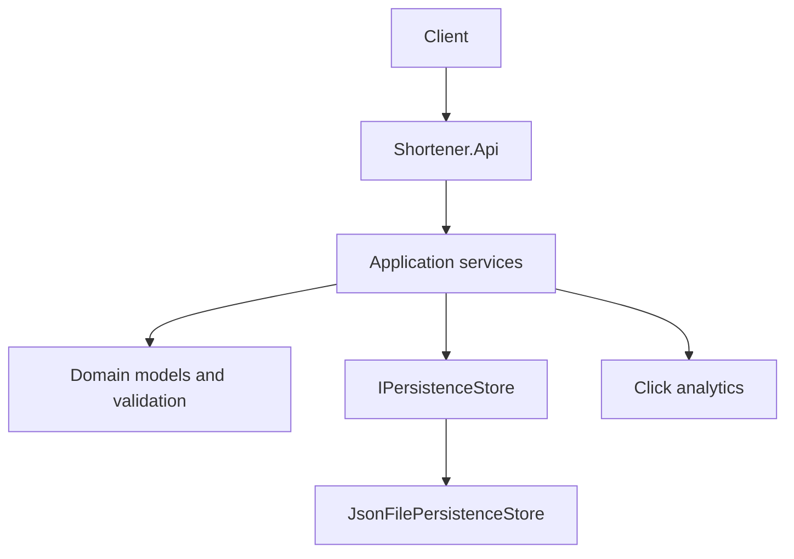
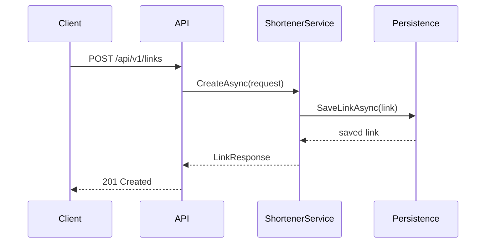

# Architecture Map

## Scenario
Greenfield; no existing solution was supplied. Stage 2 brownfield inventory is therefore not applicable. The generated solution is in `04_build/`.

## Target architecture
A layered ASP.NET Core Web API with inward dependencies:

## Cross-cutting concerns
- Dependency injection wires the service and persistence store.
- ASP.NET Core ProblemDetails handles error shape.
- `ILogger<T>` records operational events without secrets.
- Options pattern configures storage path and public base URL.
- The persistence interface is the replacement seam for PostgreSQL/Redis in production.
