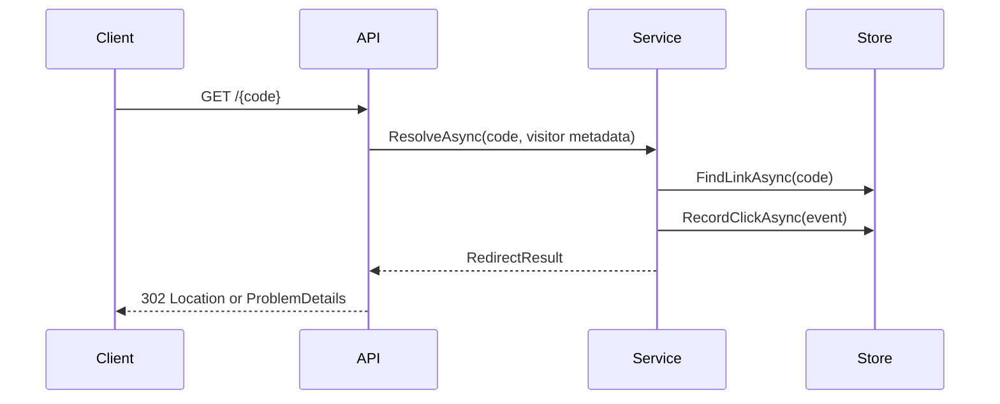

# Design and Trade-offs

## Components
- **API**: ASP.NET Core minimal APIs; maps HTTP requests to application operations.
- **Application**: `ShortenerService`; validates URLs/aliases, generates codes, manages redirects and analytics.
- **Domain**: immutable records for links, clicks, and analytics.
- **Persistence**: `IPersistenceStore`; demo implementation stores a single JSON document atomically via temp-file replacement.

## Key flow: redirect

## ADR-001: Minimal API and single deployable
- Options: MVC controllers, minimal APIs, separate services.
- Decision: minimal APIs in one deployable for a small, clear surface.
- Consequences: low ceremony and fast startup; endpoint organization must remain disciplined.

## ADR-002: JSON file for demo persistence
- Options: JSON file, SQLite/EF Core, PostgreSQL plus Redis.
- Decision: JSON file with an interface for zero-dependency local execution.
- Consequences: restart durability and easy demo; not appropriate for multi-instance writes or high throughput. Production replaces the provider with a transactional database and cache.

## ADR-003: Hash visitor identity
- Options: raw IP, salted hash, anonymous event only.
- Decision: SHA-256 of IP and user-agent, stored only as a fingerprint.
- Consequences: supports unique visitor counts without retaining raw IP; a production deployment should add a rotating secret salt and retention policy.

## Scalability path
1. Replace `JsonFilePersistenceStore` with PostgreSQL/EF Core using unique index on code and transactional click writes.
2. Add Redis read-through cache for active codes.
3. Publish click events to a queue and aggregate asynchronously for high traffic.
4. Add rate limiting, authentication, quotas, and multi-region policy as product requirements mature.
